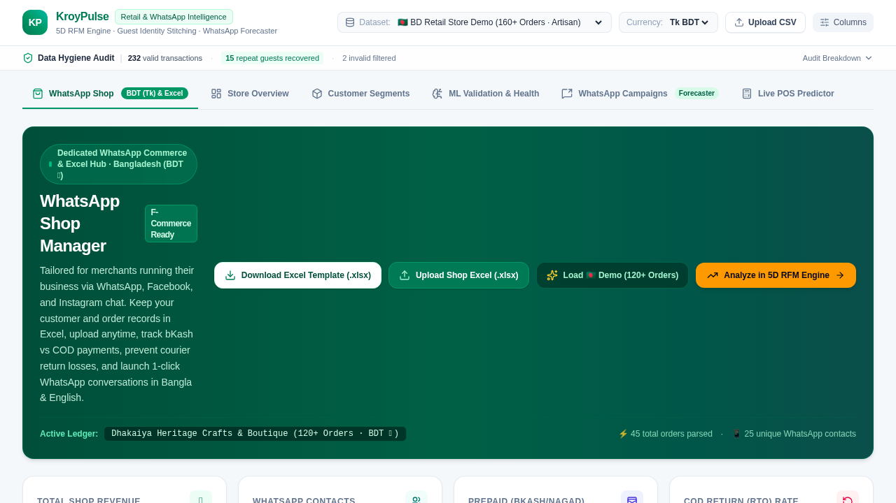
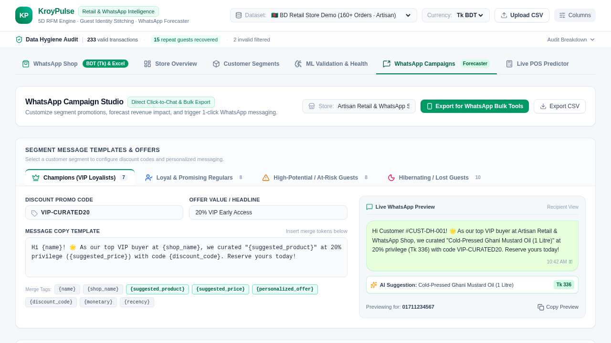
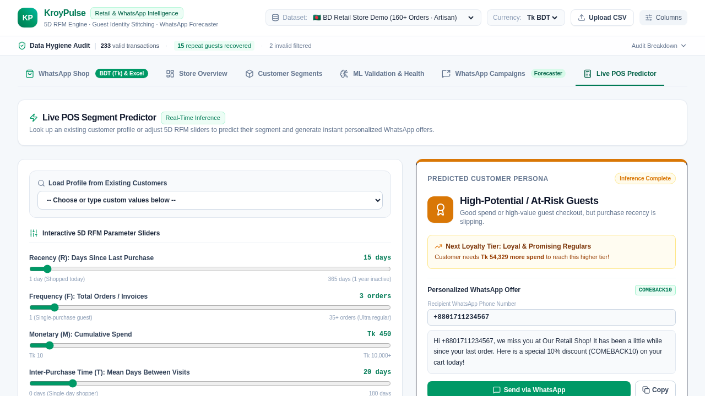
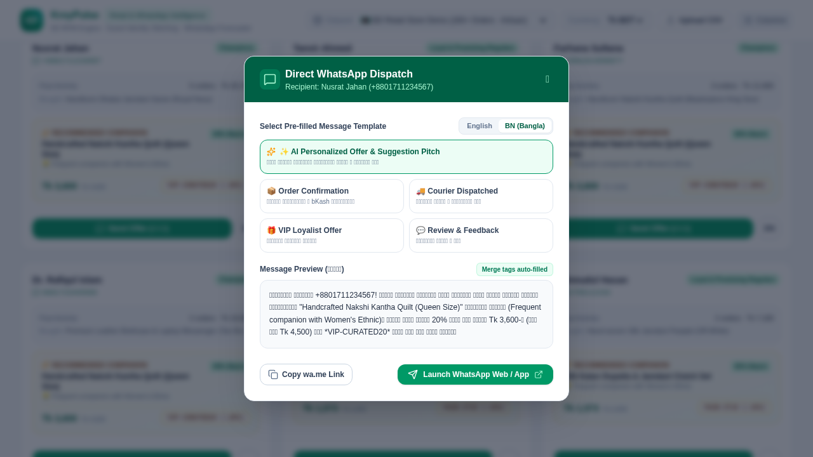

# 🛍️ KroyPulse — Universal Retail & F-Commerce Customer Segmentation Web App

[](https://react.dev/)
[](https://www.typescriptlang.org/)
[](https://vitejs.dev/)
[](https://streamlit.io/)
[](https://tailwindcss.com/)
[](LICENSE)

> **Undergraduate Thesis Interactive System & Decision Support Platform**  
> **Department of Computer Science & Engineering, City University, Bangladesh**  
> **Supervisor:** Monoara Sultana Morzina, Lecturer, Department of CSE  
> **Authors:**  
> - **Ahammed Zihad Khan** (ID: 0272310005101036)  
> - **Shaheda Akter** (ID: 0272310005101086)  
> - **Aurnob Saha** (ID: 0272310005101095)  
> - **Md. Nazmul Hasan** (ID: 0272310005101066)  

---

## 📌 Overview

**KroyPulse** is an interactive, enterprise-grade web application bringing our thesis methodology — **Extended 5D RFM Modeling ($R, F, M, T, D$) & Unsupervised Machine Learning** — into real-world operational retail, F-Commerce (Facebook Commerce), and WhatsApp commerce environments.

While traditional segmentation systems require rigid customer accounts and only track Recency, Frequency, and Monetary value, **KroyPulse** addresses the real-world friction of social commerce:
1. **Zero-Account Identity Stitching:** Heuristically links guest orders and social chats into unified customer profiles using normalized phone numbers and transaction graphs.
2. **5D Extended RFM Metric Engine:** Ingests transaction data and computes $R$ (Recency), $F$ (Frequency), $M$ (Monetary), $T$ (Inter-Purchase Cadence), and $D$ (Basket Depth / Catalog Breadth).
3. **Interactive 3D Cluster Visualizer:** Renders high-dimensional customer cohorts in real-time.
4. **Multi-Channel Campaign Studio:** Generates click-to-chat WhatsApp direct links (`wa.me`), Messenger prompts, personalized discount codes, and CSV queue exports.
5. **Live POS / Single-Customer Predictor:** Classifies any incoming buyer on-the-fly at the point of sale.

---

## 📸 Application Screenshots

<div align="center">
  <h3>Tab 1: Store Overview & Guest Identity Resolution</h3>
  
</div>

<br />

<div align="center">
  <h3>Tab 4: WhatsApp & Social Multi-Channel Campaign Studio</h3>
  
</div>

<br />

<div align="center">
  <h3>Tab 5: Live POS / Real-Time Single-Customer Predictor</h3>
  
</div>

<br />

<div align="center">
  <h3>Personalized Dynamic Customer Offer Modal</h3>
  
</div>

---

## 🔬 Mathematical Framework: Extended 5D RFM

For each unique customer $i \in \{1, 2, \dots, N\}$ evaluated at reference snapshot date $t_{\text{ref}} = \max(\text{OrderDate}) + 1\text{ day}$:

$$\begin{aligned}
R_i &= t_{\text{ref}} - \max(t_{i, j}) && \text{(Recency: Days since last completed purchase)} \\
F_i &= |\{ \text{OrderID}_{i, j} \}| && \text{(Frequency: Total distinct order count)} \\
M_i &= \sum_{j} (\text{Quantity}_{i, j} \times \text{UnitPrice}_{i, j}) && \text{(Monetary: Total cumulative spend)} \\
T_i &= \frac{1}{F_i - 1} \sum_{k=1}^{F_i - 1} (\tau_{i, k+1} - \tau_{i, k}) && \text{(Inter-Purchase Time: Temporal interval between orders, } F_i \ge 2\text{)} \\
D_i &= |\{ \text{ItemCode}_{i, j} \}| && \text{(Basket Depth: Distinct SKUs / catalog discovery)}
\end{aligned}$$

### Feature Preprocessing & Scaling
- **$\log(1+x)$ Transformation:** Resolves extreme positive skewness in retail spend and order distributions.
- **Z-Score Normalization:** Fits features onto standardized unit variance: $z = \frac{x - \mu}{\sigma}$.

---

## 🎯 Discovered Behavioral Segments ($k=4$)

| Cluster | Segment Persona | Strategic Description | Recommended Action |
|:---:|:---|:---|:---|
| **0** | 🌟 **Champions (VIP Loyalists)** | Highest spend, frequent orders, rapid reorder cadence, wide product exploration. | VIP concierge, exclusive early access, zero-friction perks. |
| **1** | 🚀 **Loyal & Promising Regulars** | Steady recurring orders, reliable spend, high potential for lifetime value growth. | Cross-sell recommendations, bundle incentives, loyalty tier unlocks. |
| **2** | ⚠️ **High-Potential / At-Risk Guests** | Substantial past spend whose purchase cadence is slipping; high churn vulnerability. | Automated win-back discounts, personalized re-engagement via WhatsApp. |
| **3** | 💤 **Hibernating / Lost Guests** | One-off buyers or long-inactive accounts with low basket diversity. | Clearance promotions, low-cost reactivation blasts, churn win-back. |

---

## ⚡ Core Web Application Modules

### 📊 Tab 1: Store Overview & Data Hygiene
- Real-time guest order resolution and duplicate removal.
- Metrics for total revenue, average order value (AOV), guest checkout share, and recovered repeat buyer count.
- Smart Column Mapper supporting custom CSV and Excel schemas with fuzzy column header matching.

### 🎯 Tab 2: Extended RFM Segments & 3D Explorer
- Interactive 3D Scatter Plot built with Three.js / Plotly for multi-dimensional cluster exploration.
- Cohort breakdown by population share, monetary contribution, and average inter-purchase days.

### 🔬 Tab 3: Machine Learning Validation & Benchmark
- Algorithmic evaluation across **K-Means++**, **Ward Hierarchical Clustering**, and **DBSCAN**.
- Silhouette Score, Davies-Bouldin Index, and cluster size distribution validity checks ($2\% - 80\%$).

### 💬 Tab 4: Multi-Channel Campaign Studio & Dispatch
- Click-to-chat WhatsApp direct engine (`https://wa.me/{phone}?text={custom_message}`).
- Facebook Messenger & Email campaign triggers.
- Campaign ROI Forecaster with conversion probability, expected revenue, and profit simulations.
- Bulk export ready for WhatsApp Business API and CRM systems.

### ⚡ Tab 5: Live POS / Single-Customer Segment Predictor
- Instant classification for store cashiers, live-chat agents, and phone operators.
- Computes nearest centroid distance and suggests targeted up-sell / retention tactics during live checkout.

---

## 🚀 Getting Started

KroyPulse provides **two complementary interfaces**:
1. **Modern React Web App** (Full-featured production UI with Tailwind CSS & animations).
2. **Streamlit App** (Rapid Python interactive environment for defense presentations).

---

### Option A: Modern React Web Application (Recommended)

#### 1. Prerequisites
- **Node.js** (v18.0.0 or higher)
- **npm** or **bun**

#### 2. Installation
```bash
# Clone the repository
git clone https://github.com/ahammedzihadkhan/Thesis-scrap-.git
cd Thesis-scrap-

# Switch to the web-app branch
git checkout web-app

# Install dependencies
npm install
```

#### 3. Environment Setup (Optional)
If you wish to enable server-side Gemini AI features:
```bash
cp .env.example .env.local
# Add your GEMINI_API_KEY in .env.local
```

#### 4. Launch Development Server
```bash
npm run dev
```
Open your browser at `http://localhost:3000` to interact with the full application.

---

### Option B: Streamlit Python Web Application

#### 1. Prerequisites
- **Python 3.9+**

#### 2. Installation
```bash
pip install -r requirements.txt
```

#### 3. Launch Streamlit
```bash
streamlit run app.py
```
Open your browser at `http://localhost:8501`.

---

## 📁 Repository Structure (`web-app` branch)

```
kroypulse/
├── public/                       # Static web assets & icons
├── src/
│   ├── components/               # React UI components
│   │   ├── Tab1StoreOverview.tsx # Store analytics & data hygiene
│   │   ├── Tab2SegmentsExplorer.tsx # 5D RFM personas & metrics
│   │   ├── Tab3MLValidation.tsx  # Algorithm benchmark & cluster health
│   │   ├── Tab4CampaignStudio.tsx# WhatsApp & Messenger campaign dispatcher
│   │   ├── Tab5POSPredictor.tsx  # Live POS / real-time predictor
│   │   ├── ScatterPlot3D.tsx     # Interactive 3D cluster plot
│   │   ├── WhatsAppShopSection.tsx# F-Commerce order & catalog workflow
│   │   └── WhatsAppBulkExportModal.tsx # WhatsApp queue exporter
│   ├── data/                     # Preset data fixtures
│   │   ├── bangladeshiWhatsAppShopData.ts # F-Commerce order sample
│   │   └── darazSampleData.ts    # South Asian e-commerce sample
│   ├── rfm/                      # Core analytics & ML engine
│   │   ├── rfmCalculator.ts      # 5D RFM feature engineering
│   │   ├── identityStitcher.ts   # Guest order resolution & phone graph
│   │   ├── mlClustering.ts       # K-Means, Z-score scaling, Silhouette
│   │   ├── recommendationEngine.ts # Dynamic personalized offers
│   │   └── campaignForecaster.ts # ROI & conversion simulations
│   ├── App.tsx                   # Main application layout & state
│   ├── index.css                 # Global styling
│   └── main.tsx                  # React entry point
├── app.py                        # Python Streamlit alternative UI
├── requirements.txt              # Python dependencies
├── package.json                  # Node.js dependencies & scripts
├── vite.config.ts                # Vite configuration
├── tsconfig.json                 # TypeScript configuration
├── metadata.json                 # Application metadata
├── screen-home.png               # Application screenshot (Home)
├── screen-tab4-campaigns.png     # Application screenshot (Campaign Studio)
├── screen-tab5-pos.png           # Application screenshot (POS Predictor)
├── screen-offer-modal.png        # Application screenshot (Offer Modal)
├── screen-personalized-offers.png# Application screenshot (Personalized Offers)
└── README.md                     # Documentation
```

---

## 📜 Citation & Academic Attribution

If you use this web application, extended RFM algorithms, or benchmark datasets in your research, please cite:

```bibtex
@thesis{khan2026kroypulse,
  author       = {Ahammed Zihad Khan and Shaheda Akter and Aurnob Saha and Md. Nazmul Hasan},
  title        = {E-Commerce Customer Segmentation via Extended RFM Modeling and Unsupervised Machine Learning},
  school       = {City University, Bangladesh},
  department   = {Department of Computer Science & Engineering},
  year         = {2026},
  note         = {Supervised by Monoara Sultana Morzina}
}
```

---

## 📄 License
This project is open-sourced under the [MIT License](LICENSE).
