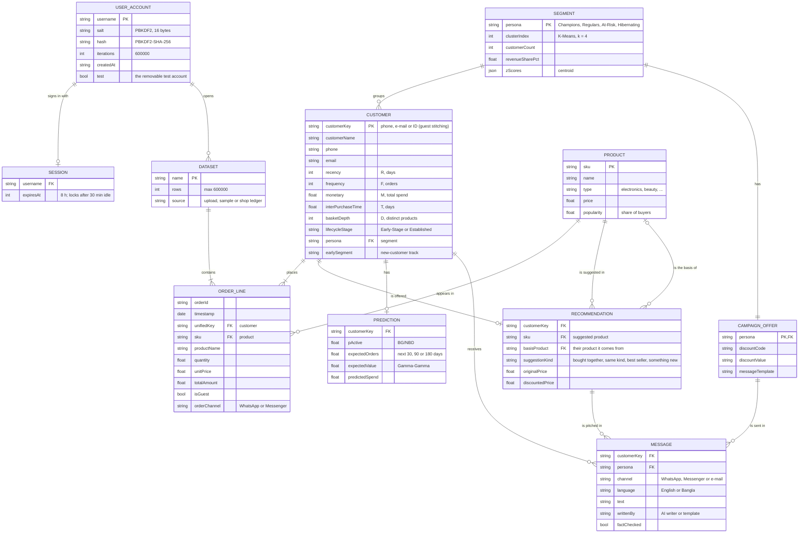

# KroyPulse data model (ER diagram)

KroyPulse has no server and no database. Everything below lives in the browser: accounts and the session in
`localStorage` / `sessionStorage`, and the shop's orders, customers, groups, suggestions, predictions and messages in
memory while the app is open. The diagram shows how these records relate, with the field names used in the code.

## How a record flows

1. The owner signs in (**USER_ACCOUNT**, **SESSION**) and opens an order file (**DATASET**).
2. The cleaner turns each row into an **ORDER_LINE**; guest orders from the same phone number become one **CUSTOMER**.
3. Each customer gets five Extended RFM features and a **SEGMENT** (K-Means, k = 4), or a new-customer group.
4. Each segment has one **CAMPAIGN_OFFER**; each customer gets a **RECOMMENDATION** (a **PRODUCT** chosen from what
   buyers of their products bought) and a **PREDICTION** (chance still active, expected orders and spend).
5. A **MESSAGE** combines the customer, their offer and their suggestion; the AI writer's draft is used only if it
   passes the fact check, otherwise the template is.
